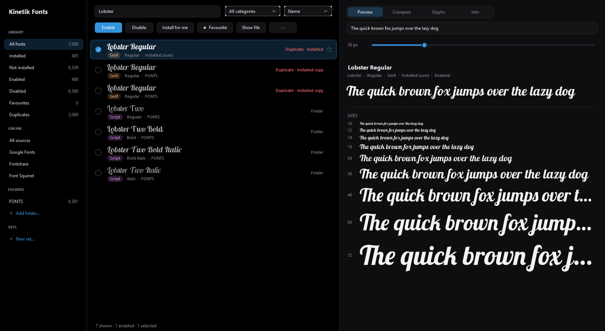
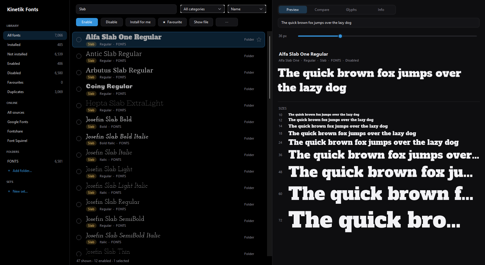
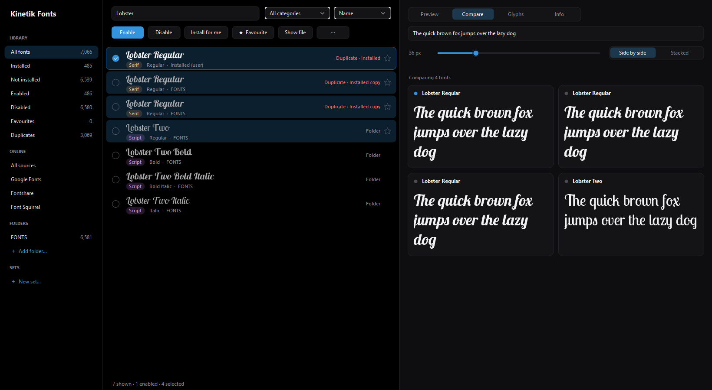
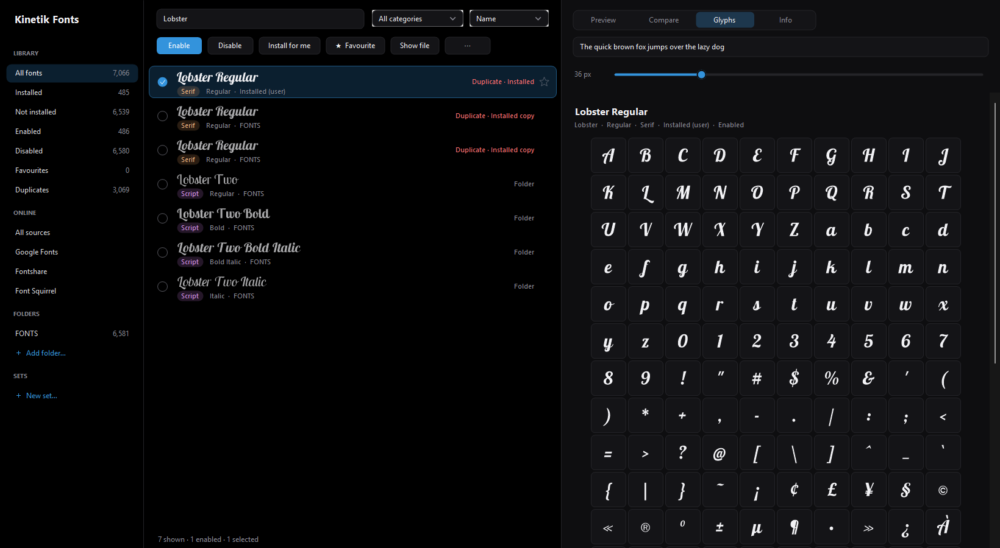
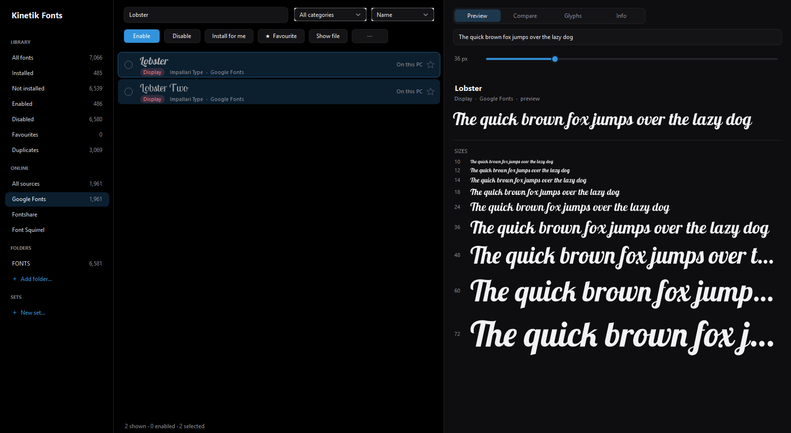

# Kinetik Fonts: font manager for Windows



[](../../releases/latest)
[](LICENSE)


**Kinetik Fonts** is a free, open-source **font manager for Windows 11 and Windows 10**. Browse every font on your PC and every font in your folders at once, with each name drawn **in its own typeface**. **Enable and disable fonts on the fly**, preview and **compare them side by side**, and let it **tag every font with a category** (serif, sans serif, script, monospace and more). It can also **search and install free fonts** from **Google Fonts**, **Fontshare** and **Font Squirrel** without leaving the app.

Fonts you keep in folders don't have to be installed to be used: switch one on and every app sees it straight away, switch it off and it's gone. Fonts that are installed in Windows can be switched off too, and back on, without touching the files.

It's one of the **Kinetik** apps, alongside [Kinetik Stats](https://github.com/WastedDesigner/Kinetik), [Kinetik Hub](https://github.com/WastedDesigner/KinetikHub), [Calendar](https://github.com/WastedDesigner/KinetikCalendar), [Clock](https://github.com/WastedDesigner/KinetikClock), [Dock](https://github.com/WastedDesigner/KinetikDock), [Feeds](https://github.com/WastedDesigner/KinetikFeeds), [Focus](https://github.com/WastedDesigner/KinetikFocus), [Notes](https://github.com/WastedDesigner/KinetikNotes) and [Weather](https://github.com/WastedDesigner/KinetikWeather), and shares their look: the same themes and accent colours, set once for every app.

> **About this project:** I made this for my own font library and decided to share it in case anyone else finds it useful. If you run into a bug or have an idea for a feature, please [open an issue](../../issues). I'll do my best to look into it and implement what I can.

## Contents

- [Features](#features)
- [Your library](#your-library)
- [Preview, compare, glyphs and info](#preview-compare-glyphs-and-info)
- [Categories](#categories)
- [Online fonts](#online-fonts)
- [Enabling, disabling and installing](#enabling-disabling-and-installing)
- [Themes](#themes)
- [Tips and shortcuts](#tips-and-shortcuts)
- [Where things are kept](#where-things-are-kept)
- [Requirements](#requirements)
- [Known limitations](#known-limitations)
- [Building from source](#building-from-source)
- [Feedback](#feedback)
- [License](#license)

## Features

- **Every font, one list:** installed fonts and any number of folders (searched through their subfolders), `.ttf`, `.otf`, `.ttc` and `.otc`
- **Names in their own fonts:** the list draws each font's name in that font, so you can scan a few thousand fonts by eye
- **Enable and disable on the fly** with one click, for one font or for a whole selection, in folders and in Windows
- **Compare** up to 30 fonts at once, side by side or stacked, with your own text and size
- **Glyph grid** of every character in a font; click one to copy it
- **Automatic categories** on every font, with a filter and a right-click override
- **Duplicates** view that finds fonts you have twice, and a **Not installed** view for fonts that only live in a folder
- **Favourites and sets:** group fonts into named sets and switch a whole set on or off together
- **Online search and install** from Google Fonts, Fontshare and Font Squirrel
- **One app theme** shared with the other Kinetik apps
- Portable: a single exe, no installer, no account, no telemetry

## Your library



The sidebar is the map of everything:

| Section | What it shows |
|---|---|
| **All fonts** | Every font Kinetik Fonts knows about |
| **Installed** | Fonts registered with Windows, system-wide or for your user |
| **Not installed** | Fonts in your folders that Windows doesn't have |
| **Enabled / Disabled** | What's switched on and off right now |
| **Favourites** | Fonts you've starred (press **F**, or click the star) |
| **Duplicates** | Fonts that share a name with another, so you can see the copies |
| **Online** | The catalogues of the three online sources |
| **Folders** | One entry per folder you added, with a count. Right-click for Rescan, Show in Explorer or Remove |
| **Sets** | Your named groups of fonts. Right-click a set to enable or disable all of it |

Above the list: a **search box** (names, categories, sources), a **category** filter and a **sort** (Name, Newest, Largest, Source, State, Popular for online fonts).

Each row shows the font in its own typeface, a category tag, the style, where it comes from and whether it's installed, a copy of something installed, or a duplicate. The circle on the left is the on/off switch.

## Preview, compare, glyphs and info

The pane on the right has four tabs, a text box for your own sample text and a size slider.



- **Preview:** your text at the size you pick, then a ladder from 10 to 72 px
- **Compare:** every font you've selected (Ctrl or Shift-click), **Side by side** or **Stacked**
- **Glyphs:** the whole character set in a grid, and a click copies a character



- **Info:** category, designer, foundry, version, licence text, file path, size and date, and whether the font is installed or a duplicate

Fonts that aren't enabled preview just as well: they're read straight from their files, and nothing is switched on in Windows by looking at them.

## Categories

Every font gets a tag: **Sans serif**, **Serif**, **Slab**, **Script**, **Display**, **Monospace**, **Symbol** or **Other**. It's worked out from what the font says about itself (its family class, PANOSE data and fixed-width flag), then from words in its name, and finally, for fonts that say nothing, from how elaborate the capital **I** is: a bare bar means sans serif and serifs mean serif.

That's right most of the time, not always. Scripts and display fonts with no hint in their name often come out as serif or sans. To fix one, right-click it → **Category** and pick the right one; **Detect automatically** puts it back. The category filter in the header and the search box both use the tags. Online fonts take the category from their source.

## Online fonts



Pick **Google Fonts**, **Fontshare**, **Font Squirrel** or **All sources** under **Online**. The catalogue loads (about two seconds, then it's cached for a week) and the search box, category filter and sort work on it as they do on your own fonts.

| Source | Fonts | Licence |
|---|---|---|
| **Google Fonts** | about 1,960 | Open source: SIL Open Font License, Apache or Ubuntu licence |
| **Fontshare** | about 100 | ITF Free Font License: free for personal and commercial use |
| **Font Squirrel** | about 1,030 | Hand-picked fonts that are free for commercial use. The licence is in the download, so read it |

- **Preview:** select an online font and a small preview file downloads, a moment after you stop on it. It's kept so it opens instantly next time.
- **Enable:** downloads the whole family into your library and switches it on.
- **Install for me:** downloads it and installs it for your Windows account, no admin needed.
- Right-click an online font for **Open on the website**.

Downloads go to `Documents\Kinetik Fonts\<source>\<family>`, and that folder is added to your library so the fonts show up like any other. Change the folder from the **⋯** menu. Only real font files are kept from a download. Nothing is sent to these sites except the requests to read a catalogue and fetch the fonts you ask for. No account, no key.

## Enabling, disabling and installing

There are three different things, and the app keeps them straight:

- **Enable a font from a folder:** loads it for the whole Windows session, so every app can use it at once. It's remembered and loaded again each time Kinetik Fonts starts. Disable it and it's removed again. The file isn't touched.
- **Disable an installed font:** removes its entry from the Windows font list; the file stays where it is, and **Enable** puts the entry back exactly as it was. Per-user fonts work normally. Fonts installed for everyone need Kinetik Fonts to run as administrator, and it tells you so if they don't. A short list of core Windows fonts (Segoe UI, Arial, Tahoma, Consolas, Marlett, Symbol and a few more) can't be disabled, because Windows' own screens depend on them.
- **Install for me:** copies a font into `%LOCALAPPDATA%\Microsoft\Windows\Fonts` and registers it for your account, the same way Windows' own Settings does. It stays after a restart.

Switching many fonts at once is fine (it asks before doing more than 300). Open apps pick the change up when they next list fonts; some only read the list when they start.

## Themes

Kinetik Fonts uses the suite's app theme: **Match Windows, Graphite, OLED black, Midnight, Nord, Mocha, Forest, Light or Paper**, with a Sky, Violet, Mint, Amber, Rose or Coral accent, or your Windows accent. Pick it from **⋯ → App theme** and every Kinetik app follows.

## Tips and shortcuts

| Do this | To |
|---|---|
| **Click the circle**, double-click a row or press **Space** | Switch a font on or off (all selected fonts if it's one of them) |
| **Click a row**, **Ctrl-click**, **Shift-click**, **Ctrl+A** | Select one, several, a range or everything shown |
| **↑ ↓ PgUp PgDn Home End** (with **Shift** to extend) | Move through the list |
| **F** or the **star** | Favourite |
| **Ctrl+F**, **Esc** | Jump to search, clear it |
| **Right-click** a font | Enable, Disable, Install, Favourite, Add to set, Category, Compare, Show in Explorer, Copy name or path |
| **Right-click** a folder or set | Rescan, Remove, Enable or Disable all, Rename, Delete |
| **⋯** menu | Add folder, Rescan, Refresh online catalogues, Download folder, Clear preview cache, App theme |

## Where things are kept

| What | Where |
|---|---|
| Settings: folders, what's enabled, favourites, sets, category choices, your sample text | `%APPDATA%\KinetikFonts\config.json` |
| Online catalogues and preview files | `%LOCALAPPDATA%\KinetikFonts\cache` |
| Fonts you download | `Documents\Kinetik Fonts` (changeable) |
| Fonts you install for yourself | `%LOCALAPPDATA%\Microsoft\Windows\Fonts` |

## Requirements

Windows 10 or 11 (64-bit) with the **.NET 8 Desktop Runtime**. Windows will offer to download it the first time you run the app if it's missing.

## Known limitations

- Folder fonts you enable stay on for the Windows session, and come back when Kinetik Fonts starts. If it isn't running after a restart, they aren't loaded until you open it.
- Web fonts (`.woff`, `.woff2`) can't be used by Windows, so they aren't listed.
- A font collection (`.ttc`) shows its first face.
- Categories are a best guess for fonts that don't describe themselves (see [Categories](#categories)).
- The first scan of a very large folder takes a few seconds; the window stays usable meanwhile.
- Disabling system-wide installed fonts needs administrator rights.

## Building from source

You need the **.NET 8 SDK**.

```
build.bat
```

That publishes a single-file `KinetikFonts.exe` into `dist\`. The source is four files: `KinetikFonts.cs` (the window), `Library.cs` (scanning, categories, enabling and installing), `Controls.cs` (the custom-drawn list, sidebar and preview) and `Online.cs` (the three sources). `SuiteSupport.cs` is the support code shared by every Kinetik app, copied in unchanged; it provides the themes and the buttons. `icon.ico` is drawn by the shared icon script in the Kinetik apps.

A few switches help when working on it:

| Switch | What it does |
|---|---|
| `--test` | Quick self-check; exit code 0 means it passed |
| `--dump <file>` | Writes every font with its detected category and the raw hints behind it |
| `--online-test <file>` | Loads all three catalogues and fetches one preview from each |
| `--get <source> <family> [install] <log>` | Downloads a family (and optionally installs it) without opening the window |
| `--shot <png> <tab 0-3> [source or -] [search] [selected]` | Renders the window to a picture, which is how the screenshots here were made |

## Feedback

Found a bug or have an idea? [Open an issue](../../issues). For a bug, say what you did, what you expected, and which Windows version you're on.

## License

Kinetik Fonts is released under the [GNU General Public License v3.0](LICENSE).

Fonts you download keep their own licences; the sources above tell you what each one allows.
